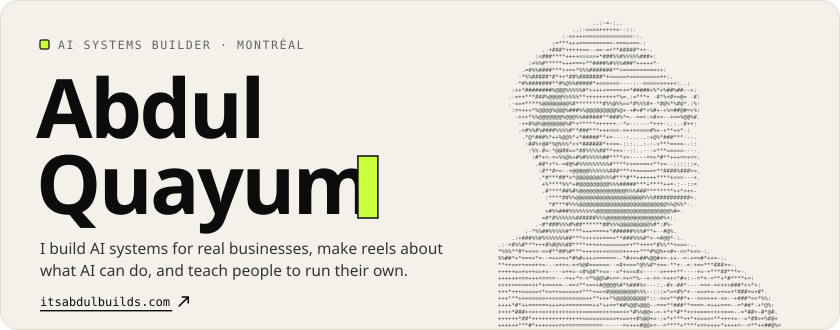
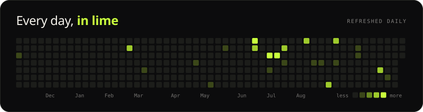
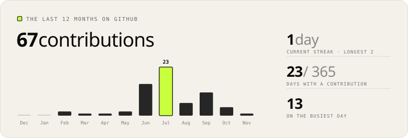
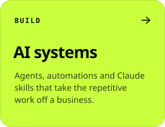
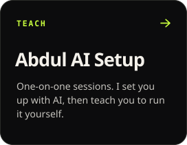
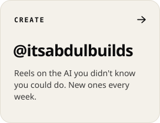
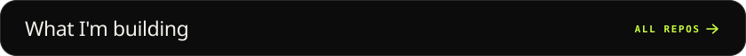
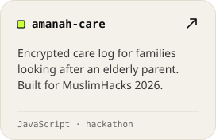
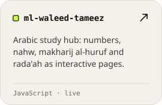
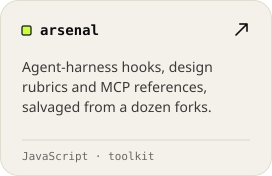

  

  

<a href="https://itsabdulbuilds.com">itsabdulbuilds.com</a> &nbsp;/&nbsp; <a href="https://www.instagram.com/itsabdulbuilds/">instagram</a> &nbsp;/&nbsp; <a href="https://x.com/buildswithabdul">x</a> &nbsp;/&nbsp; <a href="https://www.linkedin.com/in/abdul-quayum-adekunle-66b9a61a3">linkedin</a> &nbsp;/&nbsp; <a href="https://blanqdigital.com">agency work: BLANQ Digital</a>

